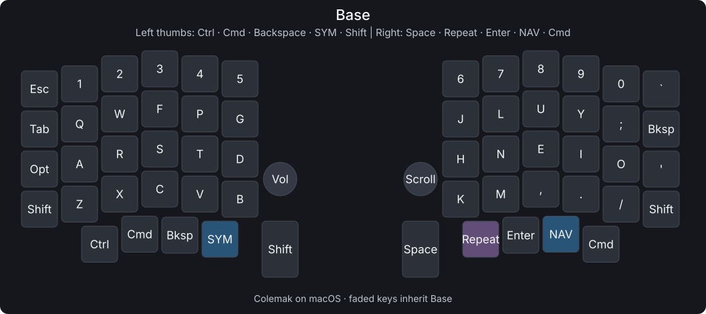
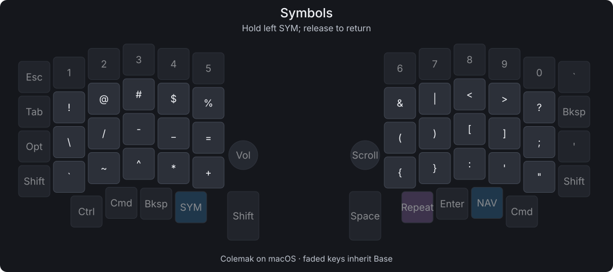
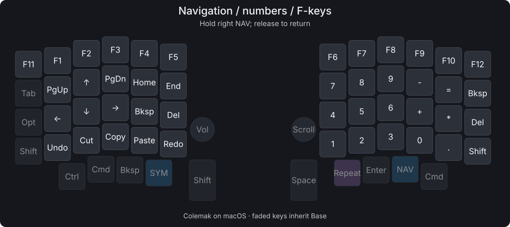

# Sofle V2

Generic Pro Micro RP2040 · Vial/QMK · three layers · cat OLEDs

**Keep macOS on Colemak.** The diagrams show the characters you type; the
firmware sends QWERTY keycodes for macOS to translate.

## Base



Option is the outer left home-row key. Use the right Cmd for Cmd+Shift,
Ctrl+Cmd, or Cmd+Backspace. Repeat repeats the previous key action:
`b`, `o`, Repeat, `k` → `book`.

Left knob: volume / press to mute. Right knob: scroll / press to play or pause.

## Symbols



Hold the left **SYM** key. Release it to return.

## Navigation, numbers and F-keys



Hold the right **NAV** key. Release it to return. Physical 1–0 become F1–F10;
Esc becomes F11 and grave becomes F12. NAV takes priority if both layers are held.
Undo, Cut, Copy, Paste and Redo use standard Mac shortcuts.

## Files

- [Firmware](dist/sofle-v2.uf2) — installed on both halves.
- [Vial layout](layout.vil) — load with Vial → File → Load saved layout.
- [Original layout](original-main.vil) — original Vial backup.
- [Sources](keymap/) · [build identity](dist/manifest.json) · [checksum](dist/SHA256SUMS).

Left OLED: cat + `@melqtx`. Right OLED: animated bongo cat.

## Build

```sh
./build.sh
```

Uses the local `.venv`, `.tools` and pinned `vial-qmk` checkout. The script
checks the compiled keymap against `layout.vil` and regenerates these images.
If changing keys in source, update the Vial layout too; verification catches mismatches.

## Flash

1. Unplug USB, then separate the halves.
2. Hold BOOT/BOOTSEL while plugging one half directly into the Mac. Release
   once **RPI-RP2** appears, then copy `dist/sofle-v2.uf2` onto it.
3. Repeat for the other half with the same file.
4. With USB unplugged, reconnect the halves, then connect USB to the left half.

Vial unlock: the four outer corners, including both outer bottom Shift keys.
