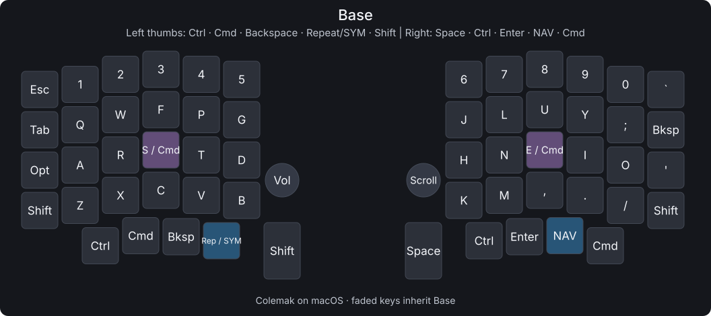
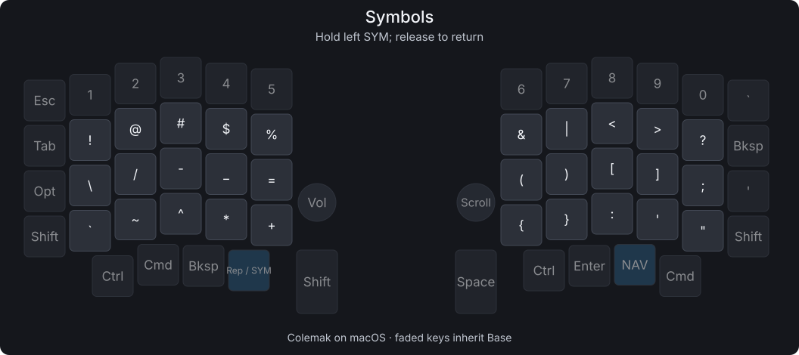
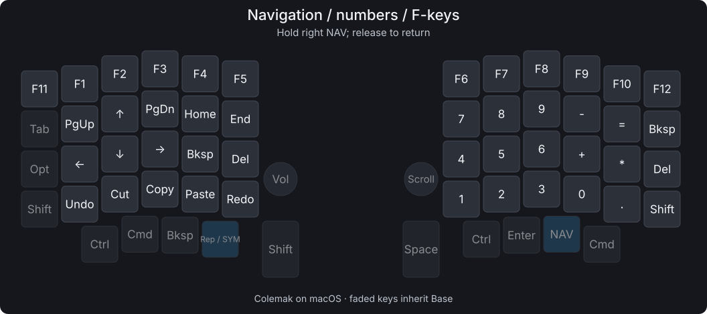

# Sofle V2

Generic Pro Micro RP2040 · Vial/QMK · three layers · cat OLEDs

**Keep macOS on Colemak.** The diagrams show the characters you type; the
firmware sends QWERTY keycodes for macOS to translate.

## Base



Tap **S/E** for letters; hold either for **Command**. Use the opposite hand:
hold right E + C/V/S; hold left S + L/Space. Plain thumb Cmd keys remain
available for mouse shortcuts and same-hand chords. Option stays on the outer
left home row; Ctrl is on both thumb clusters.

Tap the left **Repeat/SYM** key to repeat the previous action:
`b`, `o`, Repeat, `k` → `book`. Hold it for Symbols; holding does not auto-repeat.
Tab, Backspace, Shift, Space, Enter and NAV keep their positions.

Tap–hold keys use a 250 ms starting threshold. Opposite-hand chords and a 150 ms
fast-typing window help distinguish shortcuts from letters. After fast typing,
pause briefly before starting a home-row Command shortcut, or use thumb Cmd.

Left knob: volume / press to mute. Right knob: scroll / press to play or pause.

## Symbols



Hold the left **Repeat/SYM** key. Release it to return.

## Navigation, numbers and F-keys



Hold the right **NAV** key. Release it to return. Physical 1–0 become F1–F10;
Esc becomes F11 and grave becomes F12. NAV takes priority if both layers are held.
Undo, Cut, Copy, Paste and Redo use standard Mac shortcuts.

## Files

- [Firmware](dist/sofle-v2.uf2) — trial installed on both halves.
- [Vial layout](layout.vil) — load with Vial → File → Load saved layout.
- [Original layout](original-main.vil) — original Vial backup.
- [Sources](keymap/) · [build identity](dist/manifest.json) · [checksum](dist/SHA256SUMS).

Left OLED: cat + `@melqtx`. Right OLED: animated bongo cat.

## Restore the previous setup

[Backup before home-row Command](backups/before-home-row-cmd-20261018-152657/) includes the verified installed
UF2, Vial layout, sources, diagrams and checksums. To restore, flash that backup's
`dist/sofle-v2.uf2` to both halves, then load its `layout.vil` in Vial. The saved
Vial layout matters because flashing can preserve the current keymap in EEPROM.

## Build

```sh
./build.sh
./tools/test.sh
```

Uses the local `.venv`, `.tools` and pinned `vial-qmk` checkout. The script
checks the compiled keymap against `layout.vil` and regenerates these images.
If changing keys in source, update the Vial layout too; verification catches mismatches.

## Flash

1. Unplug USB, then separate the halves.
2. Hold BOOT/BOOTSEL while plugging one half directly into the Mac. Release
   once **RPI-RP2** appears, then copy `dist/sofle-v2.uf2` onto it.
3. Load `layout.vil` in Vial after flashing; the saved keymap can survive a flash.
4. Repeat for the other half with the same firmware and Vial layout.
5. With USB unplugged, reconnect the halves, then connect USB to the left half.

**Vial:** `LT(1, KC_NO)` / `0x4100` is the Repeat/SYM placeholder; the firmware
provides its Repeat action. `0x2807` and `0x380e` are the S/E Command holds.

Vial unlock: the four outer corners, including both outer bottom Shift keys.
